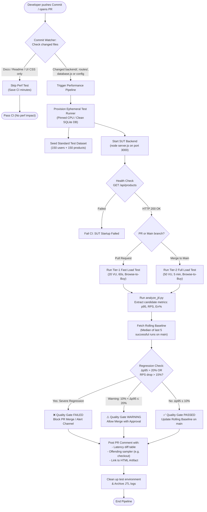

# Continuous Performance Testing Proposal (Task 3 — Disrupt)

**Project:** EShop SUT — Performance Testing  
**Author / Student ID:** 23120320  
**Target Architecture:** Node.js Express + SQLite

---

## 1. Executive Summary & Problem Statement

Trong các quy trình phát triển phần mềm hiện đại (Agile / CI/CD), kiểm thử hiệu năng (Performance Testing) thường bị đẩy xuống giai đoạn cuối (Late-stage testing) hoặc chỉ được chạy thủ công định kỳ. Cách tiếp cận này dẫn tới các hệ lụy nghiêm trọng:

1. **Phát hiện chậm (Late Detection):** Một commit làm suy giảm hiệu năng (như thiếu index, N+1 query, blocking loop) phải mất nhiều tuần mới bị phát hiện khi hệ thống đã chuẩn bị release.
2. **Chi phí sửa chữa cao:** Xác định nguyên nhân gốc rễ (root cause) giữa hàng trăm commit tốn kém gấp 10-20 lần so với việc bắt lỗi ngay tại commit gây ra.
3. **Thiếu tính định lượng tự động:** Không có chốt chặn (Quality Gate) tự động để ngăn chặn các PR làm tăng đột biến độ trễ $p95$ được merge vào nhánh chính (`main`).

**Mục tiêu của Task 3:** Đề xuất một mô hình **Continuous Performance Testing (CPT)** tự động hóa, tích hợp trực tiếp vào quy trình CI/CD (GitHub Actions / GitLab CI), có khả năng lắng nghe commit của SUT, tự động quyết định chạy test, và gắn cờ cảnh báo / chặn merge khi phát hiện suy giảm độ trễ $p95$ (p95 regression).

---

## 2. Mô hình Kiến trúc Pipeline (End-to-End Architecture)

Mô hình Continuous Performance Testing được thiết kế theo 4 tầng hoạt động khép kín:

```
[Developer Git Push]
       │
       ▼
┌──────────────────────────────────────────────────────────┐
│ 1. Commit Watcher & Impact Analysis (Bộ lọc thông minh)  │
└──────────────────────────────────────────────────────────┘
       │
       ├─ (Không chạm code API/DB) ──► Bỏ qua (Skip)
       │
       ▼ (Chạm backend/ DB)
┌──────────────────────────────────────────────────────────┐
│ 2. Isolated Ephemeral Test Environment (Môi trường sạch) │
└──────────────────────────────────────────────────────────┘
       │
       ▼
┌──────────────────────────────────────────────────────────┐
│ 3. Multi-Tiered Performance Execution (Thực thi phân tầng│
│    • Tier 1: Micro-Load Test (10 VU, 60s) trên PR        │
│    • Tier 2: Sustained Load Test (50 VU, 5m) trên Main   │
│    • Tier 3: Stress/Spike Scheduled Weekly               │
└──────────────────────────────────────────────────────────┘
       │
       ▼
┌──────────────────────────────────────────────────────────┐
│ 4. Regression Decision Gate & Automated PR Feedback      │
│    • Tính % biến động p95 so với Rolling Baseline        │
│    • Δp95 > 20% ──► ❌ BLOCK MERGE + Comment GitHub      │
│    • Δp95 ≤ 20% ──► ✅ PASS MERGE                        │
└──────────────────────────────────────────────────────────┘
```

---

## 3. Sơ đồ Luồng Hoạt động (Mermaid Flowchart)



---

## 4. Cơ chế Chi tiết của Pipeline

### 4.1. Bộ lọc Thay đổi Thông minh (Commit Watcher & Path Filtering)

Để tránh lãng phí thời gian và chi phí CI, pipeline áp dụng bộ quy tắc lọc file (Path Filtering):

- **Trigger Full Test:** Bất kỳ thay đổi nào trong `backend/**`, `routes/**`, `database.js`, `package.json`, `server.js`.
- **Trigger Micro Test:** Thay đổi cấu hình middleware hoặc controller.
- **Skip hoàn toàn:** Các file tài liệu (`*.md`), test unit frontend, hình ảnh tĩnh (`*.png`, `*.svg`), hoặc file `.gitignore`.

### 4.2. Môi trường Thực thi Cô lập (Isolated Ephemeral Runner)

Một trong những nguyên nhân lớn nhất làm hỏng Continuous Performance Testing là hiện tượng **"Noisy Neighbor"** (môi trường cloud chia sẻ CPU khiến độ trễ bị sai lệch). Giải pháp:

- Sử dụng **Self-hosted Runner** cố định hoặc Docker Container với tài nguyên ghim cứng:
  ```bash
  docker run -d --cpus="2.0" --memory="4g" --name sut-perf eshop-backend:ci
  ```
- **Chuẩn hóa dữ liệu:** Trước mỗi lần test, cơ chế tự động nạp mới `database.sqlite` từ file template sạch và gán `login_attempts = 0`, đảm bảo kết quả giữa các lần chạy có tính so sánh tuyệt đối (determinsitic).

### 4.3. Ngưỡng Quyết định & Phát hiện Suy giảm (Quality Gate Rules)

Không sử dụng các ngưỡng cứng (hardcoded thresholds) vì môi trường CI có thể thay đổi. Thay vào đó, áp dụng cơ chế **Rolling Baseline (Trung vị của 5 commit thành công gần nhất trên nhánh `main`)**:

$$\Delta p95 = \frac{p95_{\text{candidate}} - p95_{\text{baseline}}}{p95_{\text{baseline}}} \times 100\%$$

| Tiêu chí                       |  Ngưỡng PASS (Xanh)   |     Ngưỡng WARNING (Vàng)     |            Ngưỡng BLOCK (Đỏ)            |
| :----------------------------- | :-------------------: | :---------------------------: | :-------------------------------------: |
| **Độ trễ $p95$ từng Sampler**  | $\Delta p95 \le 10\%$ | $10\% < \Delta p95 \le 20\%$  | **$\Delta p95 > 20\%$** _(Block Merge)_ |
| **Độ trễ $p95$ bước Checkout** |  $\le 25\text{ ms}$   | $25\text{ ms} - 50\text{ ms}$ |  **$> 50\text{ ms}$** _(Block Merge)_   |
| **Throughput tổng**            |     Giảm $< 5\%$      |       Giảm $5\% - 15\%$       |    **Giảm $> 15\%$** _(Block Merge)_    |
| **Tỷ lệ lỗi (Error Rate)**     |      $\le 6.5\%$      |        $6.5\% - 8.0\%$        |      **$> 8.0\%$** _(Block Merge)_      |

_(Lưu ý: Ngưỡng lỗi 6.5% được tính toán dựa trên 6.0% lỗi chủ đích của bộ dữ liệu test kiểm tra lockout FR-02)._

---

## 5. Phân tích Các Đánh Đổi Kỹ thuật (Trade-offs Analysis)

Việc triển khai Continuous Performance Testing luôn đi kèm các mâu thuẫn cần thỏa hiệp kỹ thuật:

| Yếu tố đánh đổi                                            | Thách thức / Rủi ro                                                                                                                                                          | Giải pháp thỏa hiệp (Mitigation Strategy)                                                                                                                                                                                                                               |
| :--------------------------------------------------------- | :--------------------------------------------------------------------------------------------------------------------------------------------------------------------------- | :---------------------------------------------------------------------------------------------------------------------------------------------------------------------------------------------------------------------------------------------------------------------- |
| **1. Chi phí CI (Cost) vs. Độ bao phủ (Coverage)**         | Chạy đầy đủ Stress/Soak test (10-15 phút) trên mỗi commit sẽ làm cạn kiệt ngân sách CI runner và tăng thời gian chờ PR.                                                      | **Phân tầng kịch bản (Tiered Testing):**<br>• Trên PR: Chỉ chạy Micro-Load test (60 giây, 20 VU).<br>• Khi merge vào `main`: Chạy Standard Load test (5 phút, 50 VU).<br>• Định kỳ cuối tuần (Weekly Cron): Chạy Stress/Spike test để phát hiện suy giảm dưới tải nặng. |
| **2. Báo động giả (False Alarms) vs. Độ nhạy phát hiện**   | Môi trường CI chia sẻ tài nguyên có hiện tượng CPU jitter, khiến $p95$ dao động tự nhiên 10–15%. Nếu đặt ngưỡng quá nhạy sẽ gây "báo động giả", làm nản lòng lập trình viên. | **Cơ chế Retry & Median:**<br>• Dùng Rolling Baseline (Trung vị 5 lần chạy gần nhất) thay vì 1 lần chạy đơn lẻ.<br>• Khi phát hiện $\Delta p95 > 20\%$, pipeline tự động chạy lại lần 2. Nếu lần 2 vẫn vượt ngưỡng mới chính thức block PR.                             |
| **3. Tốc độ phản hồi (Developer Velocity) vs. Độ tin cậy** | Lập trình viên muốn PR được merge trong vòng 3–5 phút. Test hiệu năng kéo dài làm nghẽn tiến độ phát triển.                                                                  | **Path Filtering & Asynchronous Check:**<br>• Chỉ kích hoạt test khi PR sửa code backend/CSDL.<br>• Cho phép merge vào nhánh `staging` trước, chạy test song song và gửi cảnh báo Slack/Discord nếu phát hiện hồi quy.                                                  |
| **4. Ô nhiễm Dữ liệu (Data Drift / Contamination)**        | Chạy test liên tục tạo ra hàng nghìn đơn hàng rác, khiến dung lượng DB phình to và làm chậm các đợt test sau một cách giả tạo.                                               | **Ephemeral Database Reset:**<br>• Mỗi lần test đều khởi tạo một instance database SQLite hoàn toàn mới từ bản snapshot chuẩn.<br>• Hủy (teardown) container ngay khi test kết thúc.                                                                                    |

---

## 6. Mẫu Cấu hình CI Thực tế (GitHub Actions Workflow)

File cấu hình `.github/workflows/perf-ci.yml` mẫu có thể tích hợp trực tiếp vào dự án:

```yaml
name: Continuous Performance Testing Gate

on:
  pull_request:
    paths:
      - "backend/**"
      - "routes/**"
      - "database.js"
  push:
    branches:
      - main
    paths:
      - "backend/**"

jobs:
  performance-gate:
    runs-on: ubuntu-latest
    steps:
      - name: Checkout Code
        uses: actions/checkout@v4
        with:
          fetch-depth: 10

      - name: Set up Node.js
        uses: actions/setup-node@v4
        with:
          node-version: 18

      - name: Set up Java for JMeter
        uses: actions/setup-java@v4
        with:
          distribution: "temurin"
          java-version: "17"

      - name: Install JMeter
        run: |
          wget -q https://archive.apache.org/dist/jmeter/binaries/apache-jmeter-5.6.3.tgz
          tar -xzf apache-jmeter-5.6.3.tgz
          echo "$GITHUB_WORKSPACE/apache-jmeter-5.6.3/bin" >> $GITHUB_PATH

      - name: Start SUT Backend with Clean DB
        run: |
          cd backend
          npm install
          node server.js &
          sleep 3
          curl -f http://localhost:3000/api/products || exit 1

      - name: Run JMeter Performance Test
        run: |
          jmeter -n \
            -t test-plans/23120320_Load_20261116.jmx \
            -l results/ci_test.jtl \
            -Jduration=60 -Jthreads=20

      - name: Evaluate Regression Gate
        run: |
          python skills/hw05-perf-testing/scripts/analyze_jtl.py \
            --file results/ci_test.jtl \
            --baseline-file results/load/23120320_Load_20261116.jtl \
            --max-p95-regression 20.0

      - name: Upload HTML Dashboard Artifact
        if: always()
        uses: actions/upload-artifact@v4
        with:
          name: jmeter-performance-dashboard
          path: results/ci_test.jtl
```
