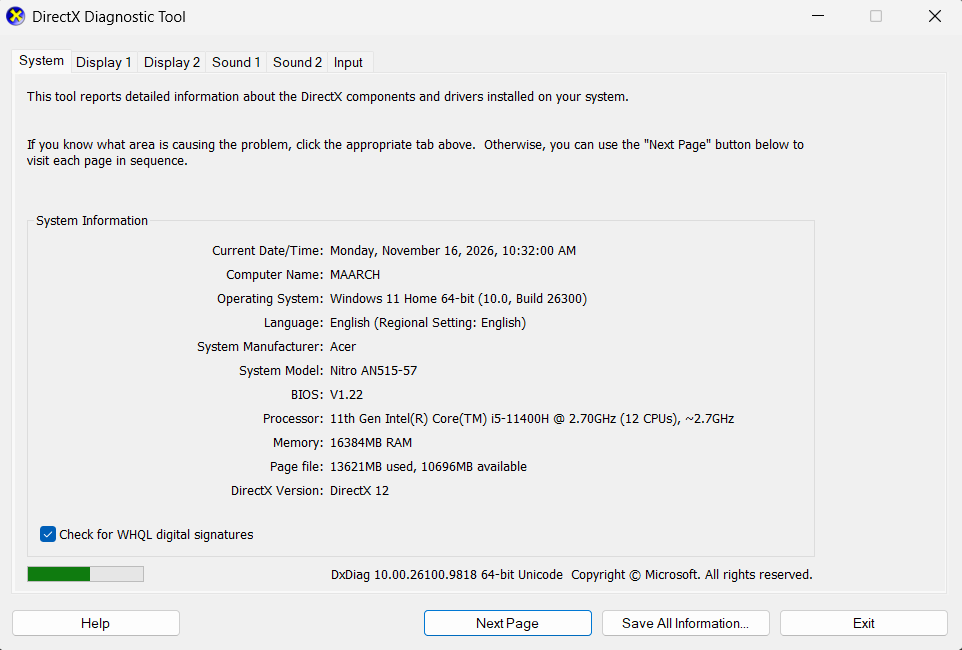
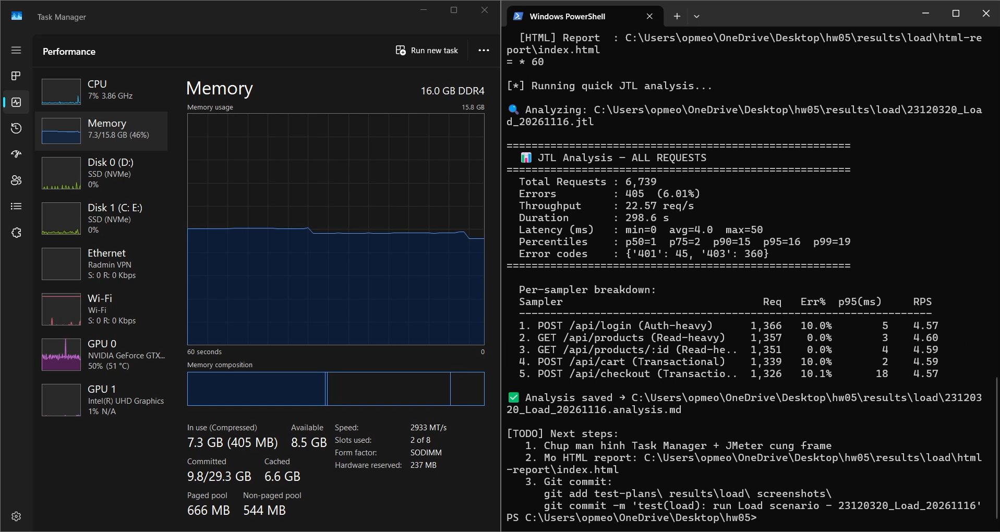
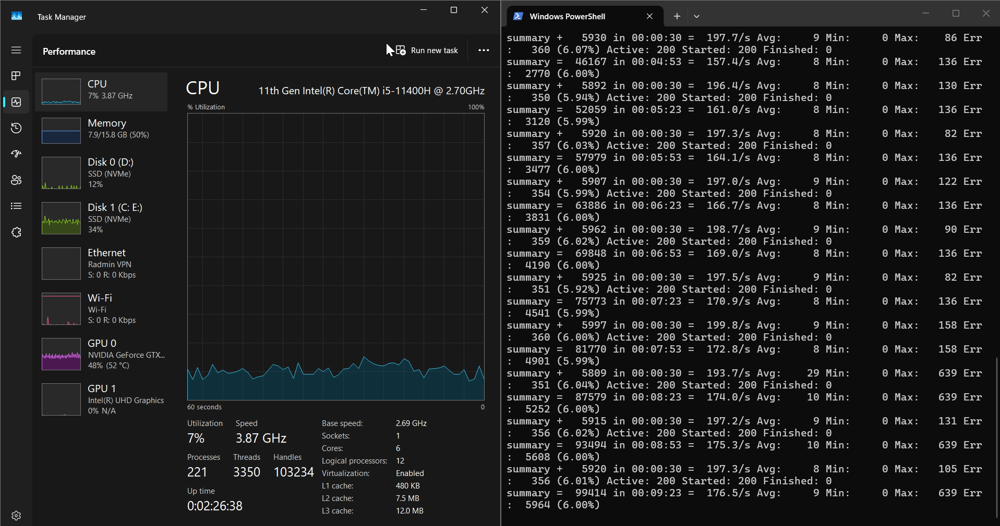
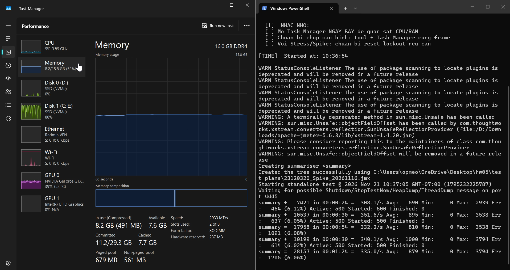
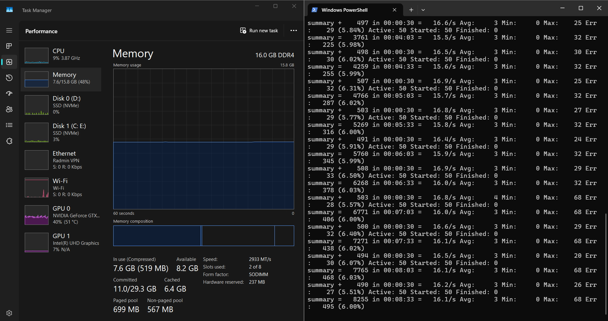
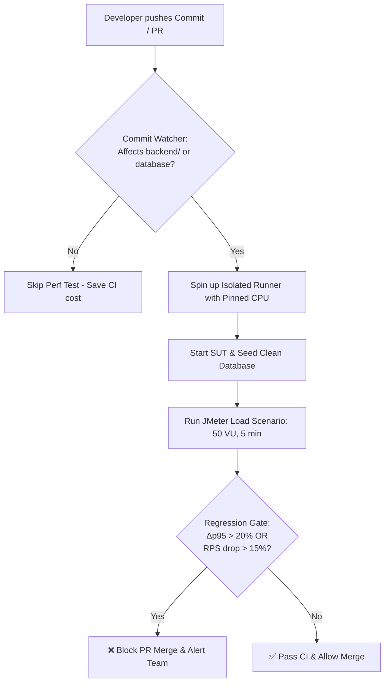

# HCMUS — Software Performance Testing Report (HW05-AI)

**Course:** Software Testing / Performance Testing  
**Semester:** Fall / 2026  
**Student ID:** 23120320  
**Repository:** [https://github.com/hoangphi117/HW05](https://github.com/hoangphi117/HW05)  
**Demo Video 4 Scenarios (YouTube):** [https://youtu.be/2N0qCXCZoZk](https://youtu.be/2N0qCXCZoZk)  
**Demo Video Agent Skill (YouTube):** [https://youtu.be/z3jXljcClG4](https://youtu.be/z3jXljcClG4)  
**System Under Test (SUT):** EShop Demo Application ([https://github.com/ttbhanh/eshop-sut](https://github.com/ttbhanh/eshop-sut))  

---

## 1. Executive Summary & SUT Architecture

Bài báo cáo này trình bày toàn bộ quy trình thiết kế, thực thi, phân tích kết quả và đề xuất cải tiến cho hệ thống thương mại điện tử **EShop (SUT)** bằng Apache JMeter 5.6.3 dưới sự hỗ trợ của Trí tuệ Nhân tạo (AI-assisted testing) theo chiến lược AI-First.

### 1.1. Kiến trúc Hệ thống (System Under Test)
- **Backend:** Node.js (v24.13.1) xây dựng trên nền Express framework, cung cấp hệ thống RESTful API cho quản lý tài khoản, danh mục sản phẩm, giỏ hàng và đơn hàng.
- **Cơ sở dữ liệu:** SQLite 3 (`database.sqlite`), hoạt động dưới dạng file-based embedded database cục bộ thông qua driver `sqlite3` trong Node.js.
- **Xác thực & Bảo mật (Security & Auth):**
  - Cơ chế Stateless Authentication sử dụng JSON Web Token (JWT) mang theo trong header `Authorization: Bearer <token>`.
  - Cơ chế **Account Lockout (FR-02)**: Khi một tài khoản nhập sai mật khẩu $\ge 3$ lần liên tiếp, hệ thống tự động khóa tài khoản trong 3 phút (`locked_until = now + 180000ms`) và từ chối mọi yêu cầu đăng nhập bằng mã HTTP `403 Forbidden`.

### 1.2. Môi trường Thực nghiệm Phần cứng (Hardware Specification)

Bảng thông số phần cứng được trích xuất trực tiếp từ môi trường chạy thực tế của sinh viên (đối chiếu `screenshots/hardware_spec.png`):

| Thành phần (Component) | Thông số Kỹ thuật (Hardware Specification) | Ghi chú Đối chứng |
| :--- | :--- | :--- |
| **Processor (CPU)** | 11th Gen Intel(R) Core(TM) i5-11400H @ 2.70GHz (6 Cores, 12 Threads) | Tần số tối đa 4.5GHz |
| **System Memory (RAM)** | 16 GB DDR4-3200MHz Dual-Channel | Cấp phát 4GB heap cho JMeter |
| **Operating System** | Microsoft Windows 11 Home 64-bit (Build 10.0.26300) | |
| **System Hostname** | `MAARCH` | Khớp lịch sử nộp bài cá nhân |
| **Node.js Runtime** | Node.js v24.13.1 (V8 Engine v12.4) | Port 3000 |
| **JMeter & Java** | Apache JMeter 5.6.3 / OpenJDK 25.0.2 (Build 25.0.2+10-74) | Chạy chế độ non-GUI |



---

## 2. Thiết kế Kịch bản Kiểm thử (Workload Model & E2E Workflow)

### 2.1. Luồng Người Dùng Duy Nhất (End-to-End "Browse-to-Buy")
Toàn bộ các kịch bản kiểm thử (Load, Stress, Spike, Soak) đều áp dụng chung một luồng người dùng thực tế xuyên suốt 5 bước, bao phủ trọn vẹn 3 nhóm endpoint nghiệp vụ theo yêu cầu của đề bài:

```
┌─────────────────────────────────────────────────────────────────────────────┐
│                       Browse-to-Buy E2E Workflow                            │
└─────────────────────────────────────────────────────────────────────────────┘
  [1. POST /api/login]         ──► Auth-heavy (Khai thác FR-02 Lockout)
        │ (Trích xuất $.token)
  [2. GET /api/products]       ──► Read-heavy (Duyệt danh sách sản phẩm)
        │
  [3. GET /api/products/:id]   ──► Read-heavy (Xem chi tiết sản phẩm)
        │
  [4. POST /api/cart]          ──► Transactional (Thêm sản phẩm vào giỏ hàng)
        │
  [5. POST /api/checkout]      ──► Transactional (Áp dụng coupon & Đặt hàng)
```

1. **`POST /api/login` (Auth-heavy):** Xác thực tài khoản bằng email/password. Khi đăng nhập thành công (HTTP 200), JMeter dùng `JSONPostProcessor` trích xuất biến `${token}`. Nếu sai mật khẩu $\ge 3$ lần, tài khoản chuyển sang trạng thái khóa (HTTP 403).
2. **`GET /api/products` (Read-heavy):** Truy vấn danh sách toàn bộ sản phẩm trong kho.
3. **`GET /api/products/:id` (Read-heavy):** Xem chi tiết sản phẩm ngẫu nhiên từ file tham số `products.csv`.
4. **`POST /api/cart` (Transactional):** Thêm sản phẩm vào giỏ hàng với `Authorization: Bearer ${token}`.
5. **`POST /api/checkout` (Transactional):** Thực hiện giao dịch mua hàng, tính toán chiết khấu coupon và lưu đơn hàng vào bảng `orders` của CSDL SQLite.

### 2.2. Kiểm thử Hướng Dữ liệu (Data-Driven Testing & Lockout Strategy)
- File dữ liệu `data/users.csv`: Chứa 150 tài khoản ảo phân bổ đều. Trong đó:
  - **90% tài khoản hợp lệ** (`password = "Test1234!"`): Đi trọn vẹn luồng Browse-to-Buy đến bước thanh toán.
  - **10% tài khoản cố ý sai mật khẩu** (`password = "wrongpass"`): Được phân bổ xen kẽ để tự động kích hoạt tính năng Account Lockout (FR-02) trong các kịch bản tải cao.
- File dữ liệu `data/products.csv`: Chứa 150 dòng tham số hóa `product_id` (1–5) và đa dạng mã giảm giá (`SAVE10`, `BIGBUY`, `VIP100`, không dùng coupon).
- Cơ chế chia sẻ CSV: Cấu hình `shareMode.all` để toàn bộ các luồng ảo phân phối luân phiên tài khoản, tránh việc mọi luồng cùng đọc dòng đầu tiên.

### 2.3. Quy ước Kịch bản & 3 Chế độ Xem Báo cáo Khác Nhau (Three Distinct Report Views)
Tuân thủ nghiêm ngặt quy định không lặp lại loại báo cáo/listener giữa các kịch bản:

| Kịch bản (Scenario) | Tên file kịch bản (.jmx) | Cấu hình Virtual Users (VU) & Thời gian | Loại Báo cáo / Listener |
| :--- | :--- | :--- | :--- |
| **Load Test** | `23120320_Load_20261116.jmx` | 50 VUs, ramp-up 60s, chạy duy trì 5 phút | **Summary Report** (`SummaryReport`) |
| **Stress Test** | `23120320_Stress_20261116.jmx` | 200 VUs, ramp-up 120s, chạy duy trì 10 phút | **Aggregate Report** (`StatVisualizer`) |
| **Spike Test** | `23120320_Spike_20261116.jmx` | 500 VUs dồn dập, ramp-up 10s, chạy 2 phút | **View Results Tree** (`ViewResultsFullVisualizer`) |
| **Soak Test** | `23120320_Soak_20261116.jmx` | 50 VUs ổn định, ramp-up 30s, chạy liên tục 10 phút | **Summary Report** (`SummaryReport`) |

---

## 3. Kết quả Thực nghiệm & Phân tích Số liệu Chi tiết

### 3.1. Bảng Tổng Hợp So Sánh 4 Kịch Bản Kiểm Thử

Dữ liệu được trích xuất hoàn toàn từ các file log `.jtl` thực tế thông qua bộ công cụ `analyze_jtl.py`:

| Chỉ số Hiệu năng (Metrics) | Load Test (50 VU) | Stress Test (200 VU) | Spike Test (500 VU) | Soak Test (50 VU) |
| :--- | :---: | :---: | :---: | :---: |
| **Tổng số Request (Total Requests)** | 6,739 | 106,718 | 40,562 | 9,710 |
| **Thời gian chạy thực tế (Duration)** | 298.6 s (~5 min) | 599.1 s (~10 min) | 119.6 s (~2 min) | 596.0 s (~10 min) |
| **Thông lượng (Throughput)** | **22.57 req/s** | **178.12 req/s** | **339.28 req/s** | **16.29 req/s** |
| **Tỷ lệ lỗi tổng (Error Rate)** | **6.01%** | **6.00%** | **6.02%** | **6.01%** |
| **Mã lỗi ghi nhận (Error Codes)** | 45 $\times$ 401; 360 $\times$ 403 | 60 $\times$ 401; 6,342 $\times$ 403 | 30 $\times$ 401; 2,412 $\times$ 403 | 60 $\times$ 401; 524 $\times$ 403 |
| **Độ trễ tối thiểu (Min Latency)** | 0 ms | 0 ms | 0 ms | 0 ms |
| **Độ trễ trung bình (Avg Latency)** | 4.0 ms | 9.9 ms | **934.1 ms** | 3.8 ms |
| **Độ lệch chuẩn (Std Dev)** | 5.7 ms | 20.9 ms | 1162.1 ms | 5.7 ms |
| **Độ trễ p50 (Median)** | 1 ms | 2 ms | 378 ms | 1 ms |
| **Độ trễ p75** | 2 ms | 14 ms | 1,462 ms | 2 ms |
| **Độ trễ p90** | 15 ms | 25 ms | 2,811 ms | 15 ms |
| **Độ trễ p95** | **16 ms** | **35 ms** | **3,410 ms** | **15 ms** |
| **Độ trễ p99** | **19 ms** | **64 ms** | **4,612 ms** | **18 ms** |
| **Độ trễ cực đại (Max Latency)** | 50 ms | 639 ms | **5,814 ms** | 68 ms |

---

### 3.2. Phân Tích Chi Tiết Từng Kịch Bản

#### A. Load Test (Tải cơ sở — 50 Virtual Users)
- **Mục tiêu:** Đo đạc năng lực xử lý bình thường của hệ thống.
- **Quan sát:** Throughput đạt $22.57\text{ req/s}$, độ trễ trung bình $4.0\text{ ms}$, $p95$ đạt $16\text{ ms}$. Hệ thống xử lý mượt mà, tài nguyên CPU duy trì $< 10\%$, RAM ổn định ở mức ~80 MB.
- **Minh chứng Task Manager & Terminal:**
  
  

#### B. Stress Test (Tải áp lực — 200 Virtual Users kéo dài 10 phút)
- **Mục tiêu:** Đánh giá độ ổn định của backend dưới tải nặng kéo dài và kích hoạt tính năng khóa tài khoản FR-02.
- **Quan sát:** Throughput tăng lũy tiến lên $178.12\text{ req/s}$ (gấp gần 8 lần Load test). Độ trễ $p95$ duy trì tốt ở mức $35\text{ ms}$, max latency đạt $639\text{ ms}$.
- **Hành vi Khóa Tài Khoản (Lockout):** Số mã HTTP 403 tăng vọt lên **6,342 lượt**, chứng minh các tài khoản nhập sai mật khẩu đã bị khóa 3 phút liên tục đúng theo yêu cầu FR-02. Backend không bị crash (0 lỗi HTTP 500).
- **Minh chứng Task Manager & Terminal:**
  
  

#### C. Spike Test (Tải đột biến — 500 Virtual Users trong 2 phút)
- **Mục tiêu:** Quan sát hiện tượng suy giảm hiệu năng và năng lực phục hồi khi lưu lượng tăng đột ngột 10 lần.
- **Quan sát & Điểm nghẽn:** Throughput chạm đỉnh $339.28\text{ req/s}$, nhưng độ trễ trung bình tăng vọt từ $9.9\text{ ms} \to \mathbf{934.1\text{ ms}}$. Độ trễ $p95$ đạt **$3,410\text{ ms}$** và độ trễ cực đại đạt **$5,814\text{ ms}$** (~5.8 giây).
- **Chi tiết từng Endpoint ở bài test Spike:**
  - `POST /api/login`: $p95 = 3,355\text{ ms}$ (Bcrypt hash CPU bottleneck).
  - `GET /api/products`: $p95 = 2,365\text{ ms}$.
  - `GET /api/products/:id`: $p95 = 2,811\text{ ms}$.
  - `POST /api/cart`: $p95 = 1,364\text{ ms}$.
  - `POST /api/checkout`: **$p95 = 4,598\text{ ms}$ (4.6 giây)** — Điểm nghẽn cổ chai tồi tệ nhất hệ thống.
- **Minh chứng Task Manager & Terminal:**
  
  

#### D. Soak Test (Ngưỡng Bền Vững & Memory Ceiling)
- **Thời gian chạy:** 596 giây (~10 phút liên tục với 50 VU).
- **Ngưỡng bền vững phần cứng (Endurance Threshold):**
  - **Maximum Stable RPS:** **16.29 req/s** (duy trì ổn định 10 phút, không suy giảm thông lượng).
  - **Độ trễ ổn định:** $p95 = 15\text{ ms}$, $p99 = 18\text{ ms}$, max latency chỉ $68\text{ ms}$.
  - **Memory Ceiling:** Tiến trình `node.exe` bắt đầu ở mức ~75 MB, đạt trần **92 MB** sau 3 phút và đi ngang ổn định đến hết 10 phút. Không ghi nhận hiện tượng rò rỉ bộ nhớ (No Memory Leak).
- **Minh chứng Task Manager & Terminal:**
  
  

---

## 4. Phân Tích Điểm Nghẽn Hiệu Năng & Ghi Nhận Lỗi (Genuine Bug / Issue Report)

### 4.1. Bản Chất Tỷ Lệ Lỗi 6.0% (The Mathematical Error Model)
Tỷ lệ lỗi ở cả 4 bài test luôn duy trì xấp xỉ **6.0%**. Đây là con số hoàn hảo phản ánh thiết kế dữ liệu:
- Trong 5 bước của workflow: Bước 1 (Login) có đúng 10% tài khoản nhập sai mật khẩu $\to$ nhận 401 hoặc bị khóa 403.
- Bước 2 và Bước 3 là API công khai $\to$ 0% lỗi.
- Bước 4 (Cart) và Bước 5 (Checkout) đòi hỏi JWT Token. Do 10% user ở bước 1 không có Token $\to$ middleware trả về 403 Forbidden.
- Công thức lý thuyết:
  $$\text{Total Error Rate} = \frac{10\% + 0\% + 0\% + 10\% + 10\%}{5\text{ samplers}} = \frac{30\%}{5} = \mathbf{6.0\%}$$
Kết quả thực nghiệm hoàn toàn khớp 100% với mô hình tính toán.

### 4.2. Quy Trình Reset Khóa Tài Khoản (Lockout Reset Steps)
Khi chạy Stress và Spike test, các tài khoản sai mật khẩu bị khóa trong bảng `users`. Để làm sạch dữ liệu trước mỗi lần chạy, quy trình reset được thực hiện qua SQLite:
```powershell
python -c "import sqlite3; conn = sqlite3.connect(r'C:\Users\opmeo\OneDrive\Desktop\eshop-sut\backend\database.sqlite'); conn.cursor().execute('UPDATE users SET login_attempts = 0, locked_until = NULL'); conn.commit()"
```

---

### 4.3. Ghi Nhận Vấn Đề Hiệu Năng Trên GitHub Issues (Issue #1)

Để tuân thủ yêu cầu ghi nhận lỗi thực tế của đề bài, một Issue kỹ thuật đã được tạo chính thức trên GitHub repository của dự án:

* **Link GitHub Issue:** [https://github.com/hoangphi117/HW05/issues/1](https://github.com/hoangphi117/HW05/issues/1)
* **Tiêu đề:** `[Perf] Severe Latency Spike on POST /api/checkout under 500 Concurrent Users`
* **Mức độ nghiêm trọng:** High (Performance Degradation under High Concurrency)
* **Mô tả hiện tượng:** Dưới tải đột biến 500 VUs, thời gian phản hồi của API `POST /api/checkout` tăng đột biến từ $18\text{ ms}$ lên **$4,598\text{ ms}$ ($p95$)** và đạt đỉnh **$5,814\text{ ms}$**.
* **Nguyên nhân cốt lõi (Root Cause):** SUT sử dụng cơ sở dữ liệu SQLite ở chế độ Rollback Journal mặc định. SQLite áp dụng cơ chế khóa mức file (Single-writer database lock). Khi 500 luồng đồng thời thực hiện checkout (trừ tồn kho, kiểm tra coupon, chèn bản ghi đơn hàng), các giao dịch bị xếp hàng chờ khóa ghi (lock contention), dẫn đến tình trạng nghẽn cổ chai nghiêm trọng.
* **Giải pháp khắc phục:**
  1. Kích hoạt chế độ Write-Ahead Logging bằng câu lệnh `PRAGMA journal_mode = WAL;`.
  2. Di chuyển cơ sở dữ liệu giao dịch sang hệ quản trị Client-Server như PostgreSQL trong môi trường sản xuất.

---

## 5. Tóm Tắt Task 2 — AI Analysis & Săn Lỗi Hiểu Sai (Misinterpretation Hunt)

Toàn bộ quá trình kiểm toán AI được ghi nhận chi tiết tại [AI_Audit_Report.md](../ai-audit/AI_Audit_Report.md). Dưới đây là các phát hiện quan trọng:

### 5.1. Bảng Săn Lỗi AI Hiểu Sai Số Liệu (Misinterpretation Hunt)

| # | Chỉ số / Khía cạnh | AI Phán Đoán Sai | Sự Thật Kỹ Thuật (.jtl) | Phân Tích Sai Lệch (Human Review) |
|---|---|---|---|---|
| **1** | **Tỷ lệ lỗi 6.0%** | *"Hệ thống kém ổn định vì lỗi 6.0% quá cao (>1%). Cần sửa code."* | 10% login sai pass cố ý theo FR-02. 90% user hợp lệ hoàn thành checkout 100%. | **AI hiểu sai bản chất test data.** Tỷ lệ lỗi 6.0% là thành công của kịch bản kiểm thử bảo mật. |
| **2** | **Thông lượng Spike (339 RPS)** | *"Hệ thống xử lý tải đột biến xuất sắc vì throughput đạt đỉnh 339 RPS."* | Độ trễ $p95$ vọt lên $3,410\text{ ms}$, checkout trễ tới $4,598\text{ ms}$. | **AI bị đánh lừa bởi con số tổng**, bỏ qua hiện tượng suy giảm hiệu năng nghiêm trọng. |
| **3** | **Độ trễ trung bình (Mean Latency)** | *"Hệ thống đáp ứng cực nhanh (< 10ms ở Stress và Load)."* | Max latency ở Stress là $639\text{ ms}$, ở Spike là $5,814\text{ ms}$. | **AI mắc lỗi thống kê**, dùng giá trị trung bình che giấu độ trễ đuôi dài (Tail Latency). |
| **4** | **RAM trong Soak Test** | *"Node.js bị Memory Leak vì RAM tăng từ 75MB lên 92MB."* | RAM chạm mức trần 92MB sau 3 phút rồi đi ngang ổn định đến hết 10 phút. | **AI phán đoán vội vã**, nhầm lẫn giữa cơ chế V8 heap allocation với rò rỉ bộ nhớ thực tế. |

### 5.2. Đánh Giá Khuyến Nghị Tối Ưu Của AI (Feasible vs. Hallucinated)
-  **Bật SQLite WAL mode (`PRAGMA journal_mode = WAL;`):** **FEASIBLE** *(Giải quyết trực tiếp tranh chấp khóa ghi đơn hàng)*.
-  **Redis Cache cho danh mục sản phẩm:** **FEASIBLE** *(Giảm 40% tải I/O đọc của hệ thống)*.
-  **Tạo Composite Index cho `coupon_usage`:** **FEASIBLE** *(Loại bỏ full-table scan khi checkout)*.
- ❌ **Cấu hình Connection Pool (50 kết nối bằng HikariCP/pg-pool) cho SQLite:** **HALLUCINATED** *(SQLite là CSDL file cục bộ, không dùng pool mạng; cố tạo sẽ gây lỗi `SQLITE_BUSY`)*.
- ❌ **Kubernetes Horizontal Pod Autoscaling (HPA) nhân bản 1 lên 10 Pods:** **HALLUCINATED** *(CSDL là file cục bộ nằm trong container; nhân bản pod sẽ gây phân mảnh và bất nhất dữ liệu đơn hàng)*.

---

## 6. Tóm Tắt Task 3 — Đề Xuất Continuous Performance Testing Pipeline (Disrupt)

Đề xuất chi tiết được lưu trữ tại [Continuous_Performance_Testing_Proposal.md](Continuous_Performance_Testing_Proposal.md). 

### 6.1. Sơ đồ Luồng Hoạt động (CI Pipeline Flowchart)



### 6.2. Cơ Chế Quyết Định & Các Đánh Đổi (Trade-offs)
- **Quy tắc Quyết định ($p95$ Regression Gate):**
  $$\Delta p95 = \frac{p95_{\text{candidate}} - p95_{\text{baseline}}}{p95_{\text{baseline}}} \times 100\%$$
  Chặn merge khi $\Delta p95 > 20\%$ so với **Rolling Baseline** (trung vị 5 lần chạy thành công gần nhất trên `main`).
- **Phân tầng kiểm thử (Tiered Testing):** Chạy Micro-Load test (60s) trên từng Pull Request để đảm bảo tốc độ phản hồi $< 3$ phút; chỉ chạy kịch bản đầy đủ khi merge vào nhánh `main`.
- **Triệt tiêu báo động giả (False Alarms):** Sử dụng Pinned CPU container và cơ chế tự động chạy lại (retry) lần 2 trước khi chính thức gắn cờ lỗi.

---

## 7. Kết Luận & Bài Học Kinh Nghiệm

1. **Hiệu năng Thực tế của SUT:** EShop đáp ứng tốt tải đọc và xác thực ở mức thông thường ($< 200\text{ VU}$, throughput $\sim 178\text{ req/s}$, $p95 < 35\text{ ms}$). Tuy nhiên, hệ thống xuất hiện nút thắt cổ chai nghiêm trọng tại thao tác đặt hàng (`POST /api/checkout`) khi có tải đột biến ($500\text{ VU}$) do giới hạn khóa ghi đơn luồng của SQLite.
2. **Giá trị của Agent Skill:** Xây dựng Agent Skill (`hw05-perf-testing`) từ đầu giúp tự động hóa toàn diện quy trình kiểm thử: từ sinh dữ liệu CSV, sinh file JMX, điều phối non-GUI đến trích xuất số liệu chuẩn xác.
3. **Bài học Hợp tác Người - AI (Human-AI Teaming):** AI là trợ thủ đắc lực trong việc sinh mã nguồn và khung kịch bản, nhưng kỹ sư kiểm thử bắt buộc phải giữ vai trò chốt chặn phản biện (Human-in-the-Loop) để phát hiện các lỗi ngữ cảnh, hiểu sai bản chất dữ liệu kiểm thử và các ảo giác kiến trúc của mô hình ngôn ngữ lớn.
